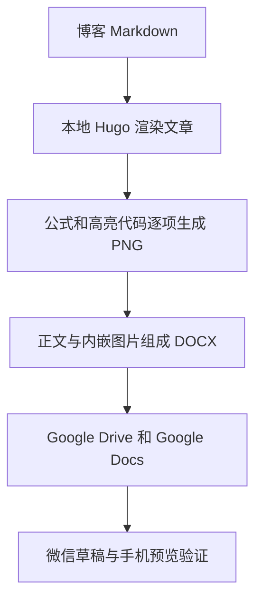

# Markdown 文章导出为微信兼容 DOCX

**状态：** 已实现本地导出命令，并生成 FlashAttention 中文 DOCX 样稿。已渲染并逐页检查中文、行内公式、高亮代码和分页；图片嵌入与正文完整性校验通过。公式、代码块和行内代码均嵌入为 PNG，正文保持可编辑。Google Drive 尚未连接；Google Docs 导入及微信实际粘贴结果仍待验证。

**目标：** 继续维护博客 Markdown，自动导出正文可编辑、公式和代码为 PNG 图片的 DOCX，供 Google Docs 编辑及微信公众号排版使用。这里将“上传到 Google”理解为上传 Google Drive 后用 Google Docs 打开或转换。

## ✅ 建议

增加一个本地导出步骤：先将全部行内公式、独立公式和代码渲染为 PNG，再生成 DOCX。已实现版本使用 Codex 文档运行环境中的 `docx` 库，避免额外安装 Pandoc。中文正文、标题、粗体、列表和链接保留为普通文档内容。图片中的代码保留语法高亮、缩进和背景；需要修改公式或代码时，修改 Markdown 后重新导出。

这需要少量定制转换逻辑。单独运行 Markdown 转 Word 命令不满足要求：Pandoc 的 DOCX 数学默认输出 OMML，也就是 Word 公式对象；`vace/markdown-docx` 的 KaTeX 路径也默认生成 OMML。[Pandoc 数学输出](https://pandoc.org/MANUAL.html#math)、[markdown-docx 数学说明](https://github.com/vace/markdown-docx#mathematical-equations)

## 🔎 现成工具的适用范围

| 方案 | 已确认的能力 | 对本需求的判断 |
| --- | --- | --- |
| [mpMath](https://github.com/latentcat/mpmath) | MathJax 渲染 SVG 公式，嵌入微信原生编辑器 | 可研究直接编辑微信公式；不是整篇 Markdown 到 DOCX 的转换器，也不负责代码图片 |
| [doocs/md](https://github.com/doocs/md) | 面向微信的 Markdown 编辑器，支持 KaTeX 和代码高亮 | 适合先试直接粘贴微信；本次查阅的功能说明没有证明它能导出本需求中的全图片公式和代码 DOCX |
| [markdown-docx](https://github.com/vace/markdown-docx) | Markdown 到 DOCX，支持公式、代码和图片 | 公式默认是 OMML，仍需要图片预处理 |
| [Pandoc](https://pandoc.org/MANUAL.html) 配合本地渲染器 | 文档结构转换、图片嵌入、可定制 filter | 推荐作为自动导出流程的基础，需实现公式和代码图片化 |

mpMath 说明的是 SVG 路线，因此“微信公式只能用 PNG”不适用于所有发布方式。对这里要求的 DOCX 中转流程，选择 PNG 是实现建议。仓库当前的 [manifest](https://github.com/latentcat/mpmath/blob/master/mpMath/manifest.json) 已声明 Manifest V3，不能仅凭插件较早发布就断言它不支持新 Chrome；但存在[无法插入新公式的反馈](https://github.com/latentcat/mpmath/issues/11)，本次没有实测它在当前微信编辑器中的表现。

## 🛠️ 本仓库的导出流程



1. **复用现有渲染。** [FlashAttention 中文稿](../content/posts/machine-learning/understanding-flashattention.zh-cn.md) 同时包含 `katex` 代码围栏、行内数学分隔符和 Hugo `katex` shortcode。建议先在本地通过 Hugo 处理，再提取文章正文；这样可以复用现有 KaTeX 和代码高亮，避免重新解释 shortcode。仅生成导出副本。
2. **逐项截图。** 等待公式排版和字体加载完成，按公式、代码块或行内代码的实际边界生成 PNG。独立公式只截取最外层数学容器，避免把其中的行内数学重复导出。Playwright 支持对单个元素截图；KaTeX 自身输出 HTML，需要浏览器渲染后再得到 PNG。[Playwright 元素截图](https://playwright.dev/docs/screenshots)、[KaTeX API](https://katex.org/docs/api)
3. **替换并组装。** 将正文中的目标元素替换为本地图片，保留行内或独立段落的位置；提取正文时去掉网站导航、目录和标题锚点。已实现版本将文档树交给 `docx` 库，明确设置中文字体、标题和段距；图片嵌入文件，不依赖外部链接。导出后校验正文文本哈希及 PNG 图片数量。
4. **保留备用图片。** DOCX 是主要交付文件，PNG 素材目录可作为微信粘贴缺图时的备用上传素材。图片里保存原公式或代码的替代文本，原 Markdown 继续作为可编辑来源。
5. **导入 Google。** 将 DOCX 上传 Google Drive 后用 Google Docs 打开；如需原生 Google 文档，再执行转换。直接编辑 Office 文件和转换成 Google Docs 是不同操作。[Google Office 文件说明](https://support.google.com/docs/answer/6055139?hl=en)、[Google Drive 上传说明](https://support.google.com/drive/answer/2424368?hl=en)

如果以后需要处理博客以外的 Markdown，可以改用 Pandoc AST 预处理：将 `Math`、`CodeBlock` 和 `Code` 节点替换为 `Image`，并先规范化 Hugo 专用语法。代码图片也可使用 Pygments 的 PNG formatter；当前仓库优先复用已经存在的渲染结果。[Pandoc Lua filters](https://pandoc.org/lua-filters.html)、[Pygments 图片输出](https://pygments.org/docs/formatters/#ImageFormatter)

## 📋 样稿验收

1. **内容完整。** DOCX 中所有公式和代码均为内嵌 PNG，正文仍可编辑；不遗留 shortcode、未渲染 LaTeX 或错误提示。代码只做高亮，不执行。
2. **图片清晰。** 高分辨率渲染后按正文尺寸嵌入。检查行内公式的基线和行高；检查长公式和代码的完整边界，避免截断或缩到无法阅读。过长代码按完整代码行分图；必要的公式分行保留原数学含义。
3. **文档排版。** 渲染 DOCX 并逐页检查中文、图片、段落和分页；再检查 Google Docs 导入后的图片大小及行内位置。
4. **微信实际链路。** 将样稿粘贴到微信草稿，保存后重新打开，再看手机预览。Google 支持 DOCX 导入不等于保证微信会接收并持久保存剪贴板中的每张图片；这一步必须实际验证。若缺图，使用备用 PNG 手动上传，或另行实现微信图片上传与 HTML 导出。

## ▶️ 运行已实现的流程

```sh
scripts/export-wechat-docx content/posts/machine-learning/understanding-flashattention.zh-cn.md --render
```

交付文件位于 `exports/understanding-flashattention.zh-cn/understanding-flashattention.zh-cn.docx`。同目录的 `manifest.json` 记录内容哈希和图片清单；`assets/` 保存备用 PNG，`_work/preview/` 保存内部校验用页面图片。环境要求与参数见 [README](../README.md#export-for-wechat)。

已解决预览工具的中文字体配置、KaTeX 样式保留、行内图片留白及正文完整性校验。此命令仅处理本仓库的 Hugo 文章；不下载外部图片。特别长的公式或代码仍需检查预览，目前未实现任意长代码的自动分图。

**下一步：** 连接 Google Drive 后导入样稿，检查导入后的行内位置和图片尺寸，再完成微信草稿保存、重新打开及手机预览验收。
