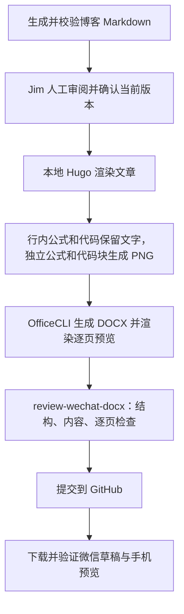

# Markdown 文章导出为微信兼容 DOCX

**状态：** 已实现本地导出命令。Jim 试用后反馈 DOCX 行内公式图片在微信中丢失，因此改为可编辑文字；行内代码也保留为文字，独立公式和代码块继续使用 PNG。增加 `review-wechat-docx` 检查步骤，Codex 与 Claude Code 共用。文件存入 GitHub；Google Drive 不参与流程。新版微信实际粘贴结果仍待验证。

**目标：** 继续维护博客 Markdown，先完成人工审阅，再导出正文及行内公式、行内代码可编辑的 DOCX，独立公式与代码块使用 PNG；完成 DOCX 检查后保存到 GitHub，供微信公众号排版使用。

## ✅ 建议

增加一个本地导出步骤：将行内公式转为带 Word 上下标的可编辑文字，嵌套上下标用字号和基线位置保留层次；保留行内代码文字，将独立公式与代码块渲染为 PNG，再生成 DOCX。已实现版本使用 [OfficeCLI](https://github.com/iOfficeAI/OfficeCLI) 生成 DOCX，并用其 HTML 渲染器生成逐页预览。中文正文、标题、粗体、列表和链接保留为普通文档内容。引用段落使用背景色：以“注意”开头用浅红色，“笔者”用浅黄色，其他引用用浅灰色。图片中的代码保留语法高亮、缩进和背景；需要修改内容时，修改 Markdown、完成人工审阅后重新导出。仅修复导出格式时复用未变更原稿的已有审阅确认。

这需要少量定制转换逻辑。单独运行 Markdown 转 Word 命令不满足要求：Pandoc 的 DOCX 数学默认输出 OMML，也就是 Word 公式对象；`vace/markdown-docx` 的 KaTeX 路径也默认生成 OMML。[Pandoc 数学输出](https://pandoc.org/MANUAL.html#math)、[markdown-docx 数学说明](https://github.com/vace/markdown-docx#mathematical-equations)

## 🔎 现成工具的适用范围

| 方案 | 已确认的能力 | 对本需求的判断 |
| --- | --- | --- |
| [mpMath](https://github.com/latentcat/mpmath) | MathJax 渲染 SVG 公式，嵌入微信原生编辑器 | 可研究直接编辑微信公式；不是整篇 Markdown 到 DOCX 的转换器，也不负责代码图片 |
| [doocs/md](https://github.com/doocs/md) | 面向微信的 Markdown 编辑器，支持 KaTeX 和代码高亮 | 适合先试直接粘贴微信；本次查阅的功能说明没有证明它能导出本需求中的全图片公式和代码 DOCX |
| [markdown-docx](https://github.com/vace/markdown-docx) | Markdown 到 DOCX，支持公式、代码和图片 | 公式默认是 OMML，仍需要图片预处理 |
| [Pandoc](https://pandoc.org/MANUAL.html) 配合本地渲染器 | 文档结构转换、图片嵌入、可定制 filter | 推荐作为自动导出流程的基础，需实现公式和代码图片化 |

mpMath 说明的是 SVG 路线，因此“微信公式只能用 PNG”不适用于所有发布方式。对这里要求的 DOCX 中转流程，选择 PNG 是实现建议。仓库当前的 [manifest](https://github.com/latentcat/mpmath/blob/master/mpMath/manifest.json) 已声明 Manifest V3，不能仅凭插件较早发布就断言它不支持新 Chrome；但存在[无法插入新公式的反馈](https://github.com/latentcat/mpmath/issues/11)，本次没有实测它在当前微信编辑器中的表现。

## 🛠️ 本仓库的导出流程



**人工审阅是必需步骤。** 先交付 Markdown，等待 Jim 确认当前版本后才能导出 DOCX。选定角度或同意开始写作不等于审阅完成。已有明确审阅确认且内容未变时直接继续；审阅后又改动 Markdown，则先交付修订稿供再次审阅。

1. **复用现有渲染。** [FlashAttention 中文稿](../content/posts/machine-learning/understanding-flashattention.zh-cn.md) 同时包含 `katex` 代码围栏、行内数学分隔符和 Hugo `katex` shortcode。建议先在本地通过 Hugo 处理，再提取文章正文；这样可以复用现有 KaTeX 和代码高亮，避免重新解释 shortcode。仅生成导出副本。
2. **按用途转换。** 行内公式从 KaTeX MathML 转为文字，保留上下标、指数、向量和分组含义；行内代码保留文字与代码字体。等待公式排版和字体加载完成，按独立公式与代码块的实际边界生成 PNG。独立公式只截取最外层数学容器。Playwright 支持对单个元素截图；KaTeX 自身输出 HTML，需要浏览器渲染后再得到 PNG。[Playwright 元素截图](https://playwright.dev/docs/screenshots)、[KaTeX API](https://katex.org/docs/api)
3. **替换并组装。** 将块级目标元素替换为独立图片段落，行内内容保持文字；提取正文时去掉网站导航、目录和标题锚点。已实现版本将文档树转换为 OfficeCLI 批量命令，明确设置中文字体、标题和段距；图片嵌入文件，不依赖外部链接。导出后执行 OfficeCLI 文档校验，并核对正文文本哈希及 PNG 图片数量。
4. **保留备用图片。** DOCX 是主要交付文件，PNG 素材目录可作为微信粘贴缺图时的备用上传素材。图片里保存原公式或代码的替代文本，原 Markdown 继续作为可编辑来源。
5. **检查并保存到 GitHub。** 执行 [review-wechat-docx](../.agents/skills/review-wechat-docx/SKILL.md)，核对 DOCX 结构、内容及每页预览，再将审阅后的 Markdown、最终 DOCX、清单和备用 PNG 纳入版本管理。导出目录位于 Hugo 内容目录之外，不生成额外博客页面；内部构建文件与预览保持忽略。提交和推送遵循用户的现有授权。

如果以后需要处理博客以外的 Markdown，可以改用 Pandoc AST 预处理：行内 `Math` 转为文字、`Code` 保留文字，仅将独立 `Math` 与 `CodeBlock` 节点替换为 `Image`，并先规范化 Hugo 专用语法。代码图片也可使用 Pygments 的 PNG formatter；当前仓库优先复用已经存在的渲染结果。[Pandoc Lua filters](https://pandoc.org/lua-filters.html)、[Pygments 图片输出](https://pygments.org/docs/formatters/#ImageFormatter)

## 📋 样稿验收

1. **内容完整。** DOCX 中行内公式和行内代码均为可编辑文字，独立公式和代码块为内嵌 PNG；不遗留 shortcode、未渲染 LaTeX 或错误提示。核对行内公式的上下标、指数、向量、撇号和分组。代码只做高亮，不执行。
2. **图片清晰。** 高分辨率渲染后按正文尺寸嵌入。图片不得与正文文字混在同一段落。检查长公式和代码的完整边界，避免截断或缩到无法阅读。过长代码按完整代码行分图；必要的公式分行保留原数学含义。
3. **文档排版。** 核对 Word 上下标、嵌套基线位置及引用段落背景色，再用 OfficeCLI 渲染 DOCX 并逐页检查中文、图片、段落和分页。上下标不得与正文或相邻行重叠，引用原有的粗体、链接和文字保持完整。
4. **微信实际链路。** 从 GitHub 下载样稿，粘贴到微信草稿，保存后重新打开，再看手机预览。需要实际确认微信会接收并保存剪贴板中的图片。若缺图，使用备用 PNG 手动上传，或另行实现微信图片上传与 HTML 导出。

## ▶️ 运行已实现的流程

```sh
scripts/install-officecli
scripts/export-wechat-docx content/posts/machine-learning/understanding-flashattention.zh-cn.md --render
```

交付文件位于 `exports/understanding-flashattention.zh-cn/understanding-flashattention.zh-cn.docx`。同目录的 `manifest.json` 记录内容哈希和图片清单；`assets/` 保存备用 PNG，`_work/preview/` 保存内部校验用页面图片。环境要求与参数见 [README](../README.md#export-for-wechat)。

已设置中文字体，并处理了KaTeX 样式保留、行内公式文字转换及正文完整性校验。此命令仅处理本仓库的 Hugo 文章；不下载外部图片。遇到不支持的行内数学结构会报错，避免静默丢失含义。特别长的公式或代码仍需检查预览，目前未实现任意长代码的自动分图。

**下一步：** 从 GitHub 下载新版样稿，完成微信草稿保存、重新打开及手机预览验收。后续文章均先审阅 Markdown，再导出 DOCX，执行 `review-wechat-docx` 后保存到 GitHub。
